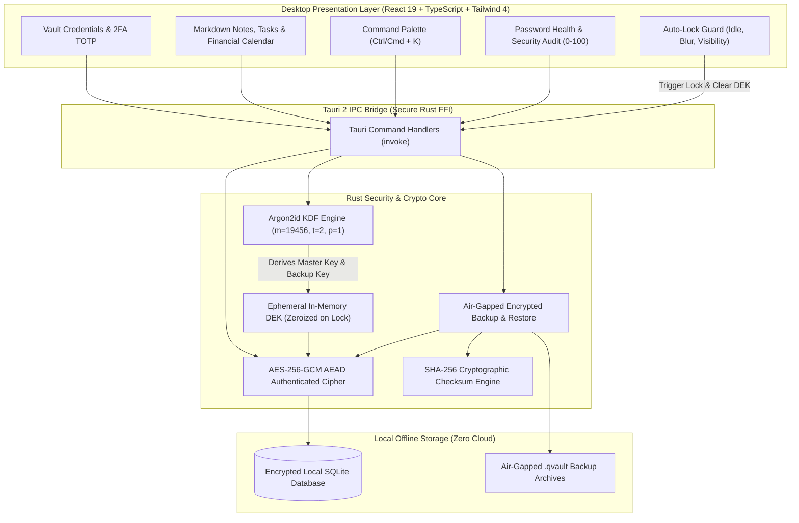

# QVAULT — Local-First Password Vault & Life OS

[](https://github.com/kianlabs/qvault/actions/workflows/ci.yml)
[](./LICENSE)
[](https://tauri.app)
[](https://www.rust-lang.org)
[](https://react.dev)


> **Q = Ky.** A sovereign, 100% offline desktop application combining an enterprise-grade encrypted password vault with a complete Life OS: markdown notes, Kanban tasks, financial calendars, and income tracking in one encrypted local workspace.

Built with **Tauri 2 + Rust + React 19 + TypeScript + SQLite**. Data at rest is encrypted using **Argon2id** (memory-hard key derivation) and **AES-256-GCM** (authenticated encryption with associated data). Zero cloud dependency, zero telemetry—your secrets never touch a remote server.

---

## Architecture & Security Model



### Cryptographic Key Hierarchy

```
master password ──Argon2id(m=19456, t=2, p=1, salt=16B)──▶ 32-byte master key
random 32-byte DEK ──AES-256-GCM──▶ wrapped by master key (stored)
sensitive fields  ──AES-256-GCM──▶ "nonce_b64:ct_b64" (stored in SQLite)
backup password ──Argon2id(m=19456, t=2, p=1, salt=16B)──▶ 32-byte backup key ──AES-256-GCM──▶ air-gapped .qvault archive
```

---

## Key Highlights & Featured Innovations

- 🔒 **Context-Aware Auto-Lock & Idle Detection**: Proactively locks the vault upon configurable user inactivity or immediately when the window loses focus / minimizes (`window blur` and `document visibilitychange` listeners). Intelligently incorporates safe pause locks (`withAutoLockPaused`) when native OS file pickers or confirmation dialogs are open, preventing premature vault locking during backups.
- 🛡️ **Air-Gapped Encrypted Backup & Integrity Checksums**: Export and import complete zero-knowledge `.qvault` encrypted archives. Derived via Argon2id with fresh salts and authenticated with AES-256-GCM, reinforced by **SHA-256 cryptographic integrity checksums** that detect corrupted or tampered records prior to execution. Restoration executes inside an ACID SQLite transaction with instant rollback on checksum mismatch.
- 🩺 **Password Health & Vulnerability Audit**: Built-in security analyzer computing a real-time 0–100 vault health score. Flags weak passwords, reused credentials, expired accounts, missing secrets, and items missing two-factor authentication, with 1-click navigation to resolve issues.
- ⏰ **Integrated 2FA Authenticator (RFC 6238 TOTP)**: Generates standard 6-digit one-time passcodes with dynamic animated countdown rings. TOTP secrets are encrypted at rest alongside credentials, removing the need for external mobile authenticators.
- ⚡ **Universal Command Palette (`Ctrl/Cmd + K`)**: Keyboard-driven navigation across every feature. Instant full-text fuzzy search across credentials, markdown notes, tasks, financial income records, and app settings.
- 📋 **Zero-Trace Clipboard Wiper**: Secrets copied to the operating system clipboard are automatically sanitized and wiped after a configurable timeout (default 30 seconds).
- 🗃️ **Integrated Life OS**: Goes beyond password management to provide encrypted markdown notes with live split preview, Kanban task tracking with deadlines, financial income stream analytics, and multi-timezone world clocks.

---

## Tech Stack Breakdown

| Layer | Technology | Details |
|---|---|---|
| **Desktop Shell** | [Tauri 2](https://tauri.app/) | Secure Rust-to-Webview bridge, minimal memory footprint |
| **Backend / Crypto** | Rust (Stable) | `rusqlite`, `argon2`, `aes-gcm`, `sha2`, `hmac` |
| **Frontend Framework** | [React 19](https://react.dev/) + [TypeScript](https://www.typescriptlang.org/) | Strict type-safety, React Router, [Zustand](https://zustand-demo.pmnd.rs/) state |
| **Styling & Theme** | [Tailwind CSS 4](https://tailwindcss.com/) | Custom CSS tokens, fluid typography, dark aesthetic |
| **Native Motion** | Web Animations & View Transitions API | Hardware-accelerated fluid view switching without heavy animation libraries |
| **Local Database** | [SQLite](https://www.sqlite.org/) | Single-file local storage, WAL mode, ACID transactions |
| **Package / Build Tool**| [Bun](https://bun.sh/) & [Cargo](https://doc.rust-lang.org/cargo/) | Lightning-fast JS bundle and native compilation |

---

## Quickstart & Local Development

### 1. Prerequisites
- **Rust (Stable)**: Install via `rustup` (`rustc --version >= 1.78`)
- **Node.js 20+** and **[Bun](https://bun.sh/)** (or `npm`)
- **Linux Dev Dependencies** (Ubuntu/Debian):
  ```bash
  sudo apt-get update && sudo apt-get install -y \
    libwebkit2gtk-4.1-dev \
    build-essential \
    curl \
    wget \
    file \
    libxdo-dev \
    libssl-dev \
    libayatana-appindicator3-dev \
    librsvg2-dev
  ```

### 2. Setup & Launching the Desktop Application

```bash
# Clone repository
git clone https://github.com/kianlabs/qvault.git
cd qvault

# 1. Install frontend dependencies
bun install

# 2. Run in desktop development mode (Vite HMR + Rust Backend)
bun run tauri dev
```

### 3. Production Compilation

```bash
# Compile optimized release binaries and native desktop installers (.deb / .AppImage)
bun run tauri build
```
Output bundles are created in `src-tauri/target/release/bundle/`.

---

## Testing & Verification Suite

Execute the dual-layer automated verification suite:

```bash
# 1. Backend Rust crypto unit tests (Argon2id, AES-256-GCM roundtrip, SQLite migrations)
cd src-tauri && cargo test && cd ..

# 2. Frontend TypeScript typechecking
bunx tsc --noEmit

# 3. Headless View Transition & motion benchmark harness
python3 tools/harness.py
```

CI (GitHub Actions via `.github/workflows/ci.yml`) automatically validates frontend typechecking and executes `cargo test` on every push and pull request to `main`.

---

## Repository Directory Structure

```
qvault/
├── src-tauri/                 # Rust desktop core
│   ├── src/
│   │   ├── crypto/            # Argon2id KDF + AES-256-GCM AEAD cipher
│   │   ├── db/                # SQLite connection, WAL mode & migrations
│   │   ├── commands/          # Tauri command handlers (security, vault, backup)
│   │   ├── models.rs          # Rust data structures & serialization
│   │   └── state.rs           # In-memory ephemeral DEK lifecycle
├── src/                       # React 19 presentation layer
│   ├── lib/                   # Crypto utils, auto-lock controller, motion tokens
│   ├── store/                 # Zustand state stores
│   ├── components/            # Sidebar, Topbar, Modals, Toasts, Form controls
│   └── features/              # Vault, Notes, Tasks, Calendar, Income, Health, Settings
└── tools/                     # Headless WebKitGTK animation & scroll-jank test harness
```

---

## License

This software is released under the [MIT License](./LICENSE) © 2025–2026 Ridzkyan Buti Pratama (Kyan).
